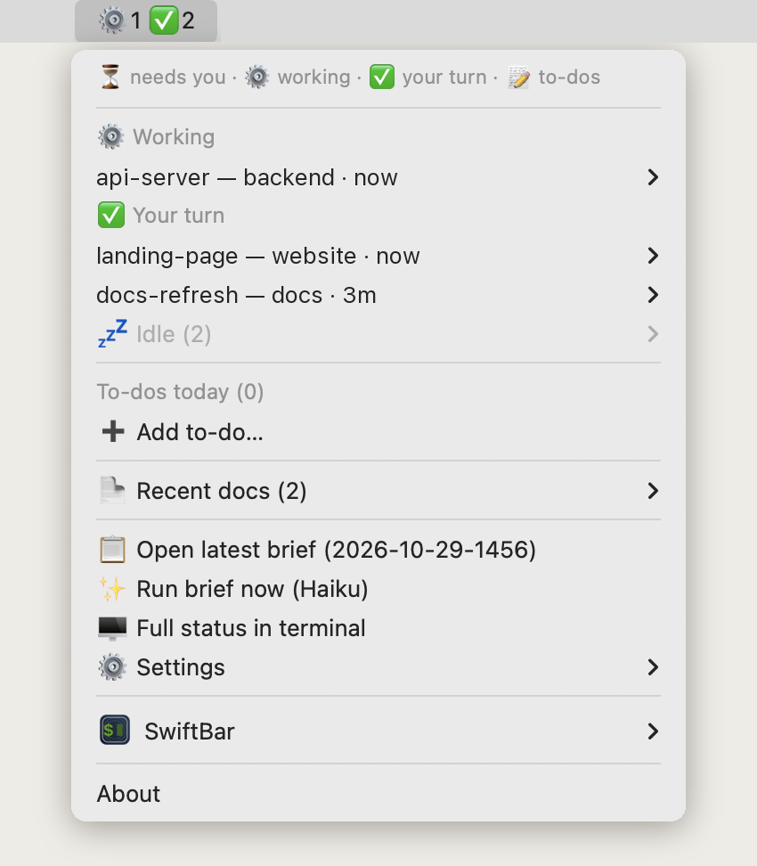
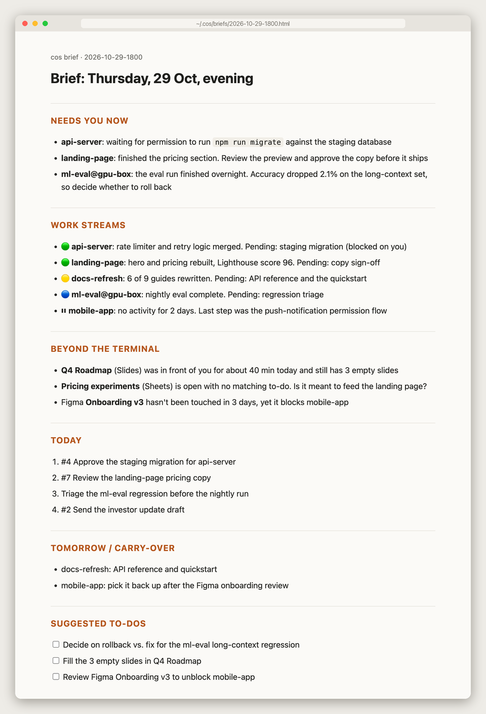
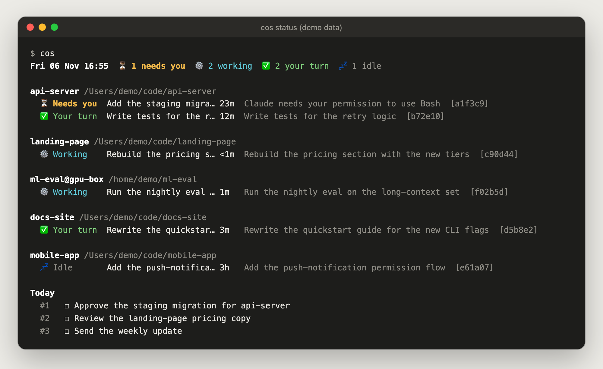
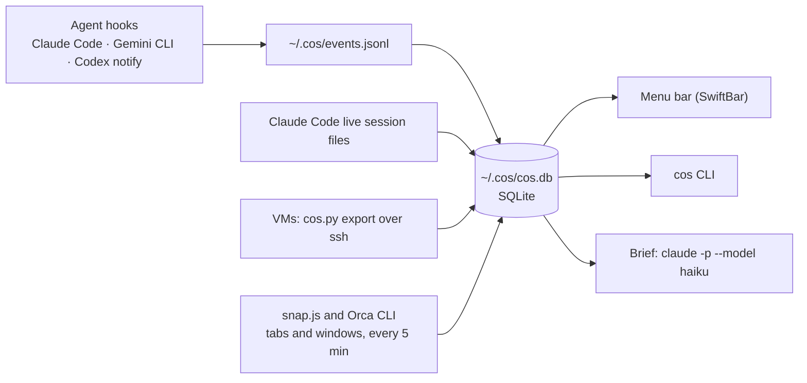

# cos: macOS menu bar and CLI to track parallel Claude Code, Gemini CLI and Codex sessions

[](https://github.com/hanshika0292/cos/actions/workflows/ci.yml)
[](LICENSE)


**cos is a free, open-source (MIT) chief of staff for developers who run several AI coding agents at once.** It tracks every Claude Code, Gemini CLI and Codex session across terminal tabs, Claude accounts and remote VMs, shows in the macOS menu bar which ones need you, and takes you to the right terminal tab in one click. It also keeps a today/tomorrow to-do list and can write a short daily brief with Claude Haiku. There's no daemon and no local model: agents report through hooks, and `cos` is a single standard-library Python file.

- **Which agent is waiting on me?** Sessions blocked on a permission prompt show as ⏳ needs you, with a macOS notification.
- **Where was that session again?** Click it to jump to its iTerm2, Terminal.app, Orca or tmux tab, or open a terminal on the VM it runs on.
- **Did that long task finish?** You get a notification when a turn that ran 5 minutes or more finishes.
- **What did all my agents do today?** An optional brief per work stream: what got done, what's pending and what needs you, including the docs and tabs you had open.
- **What's next?** Today and tomorrow to-dos, from the menu bar or `cos add "…"`.

<p align="center">
  
  &nbsp;
  
</p>
<p align="center"><sub>Menu bar (left) and an evening brief (right). Session names and brief contents are demo data.</sub></p>

## Contents

- [Features](#features) · [Quick start](#quick-start) · [What's supported](#whats-supported) · [Everyday commands](#everyday-commands)
- [Configuration](#configuration) · [Privacy](#privacy) · [How it works](#how-it-works) · [FAQ](#faq)
- [Status and limitations](#status-and-limitations) · [Uninstall](#uninstall) · [Contributing](#contributing) · [Credits](#credits) · [License](#license)

## Features

**Menu bar** (a [SwiftBar](https://github.com/swiftbar/SwiftBar) plugin that refreshes every minute). The title shows only non-zero counts: ⏳ needs you, ⚙️ working, ✅ your turn and 📝 to-dos due today. The menu lists each session with its work stream and how long ago it was active. Click one to jump to it, or open its submenu to see the last prompt (or what it's waiting for) and to hide it. The menu also has today's and tomorrow's to-dos (done, move, drop, add), recent docs from your browser, the latest brief, and settings.

**Session states.**

| | State | Meaning |
|---|---|---|
| ⏳ | Needs you | Blocked on a permission prompt |
| ⚙️ | Working | A prompt was sent or a tool is running |
| ✅ | Your turn | Finished and waiting for you. Turns idle after 2 hours, or once you open it from cos |
| 💤 | Idle | Nothing happening |
| · | Ended | Hidden unless you run `cos status -a` |

**Work streams.** Sessions are grouped by git repo (or folder) on each machine. A session on a VM shows as `repo@vm`.

**Multiple Claude accounts.** cos reads `~/.claude`, every folder in `~/.claude-profiles/`, and any extra `CLAUDE_CONFIG_DIR` you add with `cos install-hooks --dir`.

**Notifications.** When a session is blocked on a permission prompt, and when a turn that ran at least 5 minutes finishes (`cos config notify_done_min`). This works for VM sessions too.

**To-dos.** Due today, tomorrow, someday or on a date. Overdue items stay on today's list with their date.

**Daily brief (optional).** `cos brief` builds a digest of the last 24 hours (sessions, recent prompts and replies, to-dos, and the windows and docs you had open) and sends it to Claude Haiku through your own `claude` CLI. The result is saved as Markdown and HTML in `~/.cos/briefs/`, and you open it as a clean page in your browser from the menu bar or with `cos open-brief`. `cos schedule` runs it daily and notifies you when it's ready. `cos brief --apply` adds its suggested to-dos to your list.

**Window and doc tracking (optional).** Every 5 minutes cos records browser tabs, iTerm and Orca terminal tabs and other apps' window titles, and how often each was in front. Google Docs, Sheets, Slides and Forms, Figma, Notion, Canva, Linear, GitHub PRs and issues, and Claude artifacts show up under "Recent docs" and in the brief.

**Remote VMs.** `cos remote add` copies `cos.py` and the hook to a VM over ssh and installs the hooks there. The menu bar then pulls new events from it every 5 minutes.

**Light.** No daemon and no local model. Agents report through hooks that append one line to a file. The menu bar reads local files once a minute (about 0.1 s of CPU). The only LLM call is the brief.

## Quick start

```sh
curl -fsSL https://raw.githubusercontent.com/hanshika0292/cos/main/install.sh | sh
```

Or clone the repo and run the installer from the checkout:

```sh
git clone https://github.com/hanshika0292/cos.git
cd cos
./install.sh
```

The installer links a `cos` launcher into `~/.local/bin` (when piped from curl, it first clones the code into `~/.cos/app`). A short guided setup then:

1. finds your agents (`~/.claude`, `~/.claude-profiles/*`, `~/.gemini`, optionally Codex) and adds cos's hooks **alongside** any hooks you already have (backups saved as `settings.json.cos-bak`)
2. installs [SwiftBar](https://github.com/swiftbar/SwiftBar) for the menu bar (free, via Homebrew)
3. asks whether to track browser tabs, terminal tabs and app windows
4. offers to track any VM you're currently ssh'd into
5. offers a daily brief at 09:00 and 18:00

**Requirements:** macOS, Python 3.6+ (`xcode-select --install`) and git. Homebrew, or a manual SwiftBar install, for the menu bar. Claude Code for briefs.

Then check that everything is wired up and see your sessions:

```sh
cos doctor    # hooks, launcher, menu bar, macOS permissions, VMs
cos           # status by work stream + today's to-dos
```

**Updating:** run `git pull` in your checkout, or re-run the curl command (it runs `git pull` in `~/.cos/app`). To skip the setup questions on a re-run, use `curl -fsSL … | COS_SKIP_SETUP=1 sh`.

## What's supported

| | |
|---|---|
| **Agents** | Claude Code (multiple accounts via `CLAUDE_CONFIG_DIR`), Gemini CLI, Codex (experimental, wraps its `notify` setting) |
| **Jump-to-session** | Orca, iTerm2, Terminal.app, tmux (local and on VMs); Ghostty, Warp, VS Code and WezTerm are brought to the front |
| **VMs** | anything you can reach with key-based `ssh` (user@host, ssh-config aliases, Tailscale) and `gcloud compute ssh` |
| **Window tracking** | Chrome, Safari, Arc, Brave and Edge tabs, iTerm and Orca tabs, other apps' window titles |
| **Docs it recognises** | Google Sheets / Slides / Docs / Forms, Figma, Notion, Canva, Linear, GitHub PRs and issues, Claude artifacts |

## Everyday commands

```text
cos                         status by work stream + today's to-dos (cos status -a includes ended sessions)
cos add "text"              to-do for today   (-t tomorrow · -w someday · -d 2026-11-03 · "tmr: …")
cos done 3 · drop 3 · move 3 tomorrow · today · tomorrow · todos · log
cos brief [--apply]         AI brief now (--apply adds its suggested to-dos; --dry-run only prints the digest)
cos open-brief              open the latest brief in your browser
cos schedule 09:00 18:00    run the brief daily (cos schedule --off)
cos remote add NAME TARGET  track a VM: user@host, an ssh alias, or gcloud:INSTANCE:ZONE:PROJECT
cos remote list · remote rm NAME · pull [NAME]
cos windows · snap          tabs/windows seen in the last 24 hours · record them now
cos config                  settings (see below)
cos doctor · setup · uninstall [--purge]
```

<p align="center">
  
</p>

## Configuration

Settings live in `~/.cos/config.json`. Show them with `cos config`, change them with `cos config KEY VALUE`, or use **Settings** in the menu bar.

| Setting | Default | What it does |
|---|---|---|
| `notify_done_min` | `5` | Notify when a turn that ran at least this many minutes finishes. `0` turns it off |
| `snap` | `true` | Record browser tabs, terminal tabs and app windows |
| `brief_windows` | `true` | Include window titles and docs in the brief |
| `snap_exclude` | mail, banking, password-manager and login pages | Tabs and windows whose URL or title contains any of these are never recorded. Edit with `cos config snap_exclude add TEXT` or `rm TEXT` |
| `terminal` | `iTerm` if installed, else `Terminal` | App used to open a terminal on a VM when you click a VM session |

Environment variables:

| Variable | Used by | What it does |
|---|---|---|
| `COS_HOME` | everything | Data folder. Default `~/.cos` |
| `COS_SKIP_SETUP` | `install.sh` | Install the launcher but skip the guided setup (run `cos setup` later) |
| `COS_NONINTERACTIVE` | `install.sh` | Run the setup with default answers (`cos setup --yes`) |
| `CLAUDE_CONFIG_DIR` | the hook | Read to record which Claude account a session belongs to |

cos doesn't read API keys or `.env` files. The brief uses whatever account your `claude` CLI is logged in to (`cos brief --profile DIR` picks another `CLAUDE_CONFIG_DIR`).

## Privacy

Everything stays in `~/.cos` on your Mac:

- **Sessions:** prompts, the agent's last reply, and folder names
- **Windows:** titles and URLs, kept for 7 days
- **To-dos and briefs**

Nothing is sent anywhere, except when a brief runs: it sends that digest to Claude through your own `claude` CLI and account. Run `cos brief --dry-run` to see exactly what would be sent.

- Window tracking records titles and URLs only, never page contents. Incognito windows in Chrome, Arc, Brave and Edge are never recorded. There's no equivalent check for Safari private windows.
- Tabs matching mail, banking, password-manager and login pages are skipped by default. Change this with `cos config snap_exclude add <text>` or `cos config snap_exclude rm <text>`.
- `cos config brief_windows false` keeps window titles out of the brief.
- `cos config snap false` turns window tracking off entirely.
- The hook keeps only the session id from tool events, never tool inputs or outputs.

## How it works



- `hooks/cos-hook.sh` is a POSIX shell script. It writes one JSON line per event and prints nothing. It skips tool payloads (only the session id is kept) and the brief's own `claude -p` runs. On macOS it also triggers the notifications.
- `cos.py` is a single stdlib-only Python file. It reads new lines from `events.jsonl` and Claude Code's live session files (`<config>/sessions/*.json`) into SQLite, then prints the status, the menu or the digest. The same file runs on VMs (`cos remote add` copies it there) and answers `cos pull` with new events plus its live sessions.
- `snap.js` is JXA (JavaScript for Automation). It makes one bulk Apple Event per app and never launches an app that isn't already running.
- The menu bar plugin starts the 5-minute background work (VM pulls and the window snapshot), so there's no separate daemon.

The first time window tracking runs, macOS asks whether SwiftBar may control your browsers (Automation). Other apps' window titles also need SwiftBar enabled under Accessibility.

### Files

```text
cos.py               the whole app: hook setup, ingest, status, menu bar, brief, VMs, to-dos
hooks/cos-hook.sh    agent hook (also copied to VMs)
snap.js              tab and window snapshot (macOS, JXA)
install.sh           installer and launcher
tests/smoke.sh       hook -> ingest -> CLI round-trip in a throwaway COS_HOME
```

In `~/.cos`: `events.jsonl` (rotated at 20 MB), `cos.db`, `config.json`, `briefs/`, `brief.log` and the `bin/cos` launcher.

## FAQ

**How do I know when Claude Code is waiting for permission?**
cos's hook sees Claude Code's permission-prompt notification, marks the session ⏳ needs you in the menu bar and sends a macOS notification naming the repo. Click the session to jump to its terminal tab.

**Can I monitor Claude Code sessions running on a remote VM or server over SSH?**
Yes. `cos remote add NAME user@host` (or an ssh alias, or `gcloud:INSTANCE:ZONE:PROJECT`) installs cos and its hooks on the VM. Its sessions then appear as `repo@NAME`, and clicking one opens a terminal on the VM, re-attached to the session's tmux pane when there is one. The VM needs Python 3.6+ and key-based ssh.

**Does it work with several Claude Code accounts?**
Yes. Every config folder (`~/.claude`, `~/.claude-profiles/*`, or one added with `cos install-hooks --dir`) gets the hooks, and cos records which account each session belongs to.

**Does cos work with Gemini CLI and OpenAI Codex CLI?**
Gemini CLI is supported through its hooks in `~/.gemini/settings.json`. Codex support is experimental: cos wraps Codex's `notify` command (keeping any command you already had there). Codex only reports when a turn finishes, so its sessions never show as ⏳ needs you or ⚙️ working.

**Does cos send my prompts or code anywhere?**
No. All data stays in `~/.cos`. The only thing that leaves your Mac is the brief's digest, sent through your own `claude` CLI when you run or schedule a brief.

**Do I need the menu bar?**
No. The `cos` CLI works on its own. Without the menu bar, VM pulls and window snapshots don't run in the background: use `cos pull` and `cos snap` (`cos brief` also pulls VMs).

**How much does the daily brief cost?**
One short `claude -p --model haiku` call per brief, counted against your own Claude usage. `cos brief --dry-run` prints the digest without calling Claude.

**How do I remove the hooks and uninstall cos?**
Run `cos uninstall`. See [Uninstall](#uninstall).

## Status and limitations

- **Early, used daily on one setup:** an Intel MacBook running two Claude Code accounts in Orca and iTerm, Gemini CLI, and one Ubuntu VM over ssh. Codex and `gcloud` VMs are covered only by the smoke test so far.
- **macOS only** for the menu bar, notifications and window tracking. VMs can be any Linux or macOS machine with Python 3.6+.
- **Jumping to a session** works for Orca, iTerm2, Terminal.app and tmux. Other terminals are only brought to the front.
- **VM updates arrive by polling** every 5 minutes, so a VM session that needs you can take up to 5 minutes to show up.
- **Sessions started before installing** appear right away but have no prompt history until their next prompt. The brief reads Claude transcripts to fill the gap.
- **Window tracking needs macOS permissions** (Automation for browsers, Accessibility for other apps). It records titles and URLs only, never page contents.
- **Briefs need the Claude Code CLI** and count against your own Claude usage (one short Haiku call each).

## Uninstall

```sh
cos uninstall          # removes hooks (also on VMs), the menu bar plugin, the schedule and the launcher link; keeps ~/.cos
cos uninstall --purge  # …and deletes ~/.cos
```

SwiftBar itself stays installed (`brew uninstall --cask swiftbar` removes it).

## Contributing

Issues and pull requests are welcome, especially adapters for more agents and terminals.

```sh
sh tests/smoke.sh      # hook → ingest → CLI round-trip in a throwaway COS_HOME
```

Please keep `cos.py` standard-library only and Python 3.6 compatible, since it also runs on older VMs. By contributing, you agree that your contribution is licensed under the MIT License.

## Credits

- [SwiftBar](https://github.com/swiftbar/SwiftBar) by Ameba Labs (MIT) runs the menu bar plugin. It's installed separately and not included here.
- cos plugs into the hook systems of [Claude Code](https://claude.com/claude-code) and [Gemini CLI](https://github.com/google-gemini/gemini-cli), and into the `notify` setting of [Codex](https://github.com/openai/codex).

No third-party code is included. See [THIRD_PARTY_NOTICES.md](THIRD_PARTY_NOTICES.md).

## License

cos is released under the [MIT License](LICENSE). Copyright (c) 2026 Hanshika Gupta.
